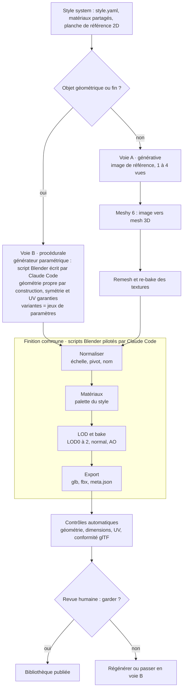

# Cahier des charges – Bibliothèque d'assets 3D

> Copie du document « Cahier des charges – Bibliothèque d'assets 3D », exportée le 17 oct. 2026. Ne la modifie pas ici : elle est régénérée depuis le document. Voir [README.md](README.md).

9 oct. 2026 · Nohé

Audit des écrans, fonctionnalités, plan de développement et glossaire : [Audit fonctionnel](02-audit-fonctionnel.md) · [Fonctionnalités](03-fonctionnalites.md) · [Plan de développement](04-plan-de-developpement.md) · [Glossaire](05-glossaire.md)

## Vision et objectifs

Objectif : une bibliothèque personnelle d'assets 3D d'une qualité proche du fait main, réutilisable dans mes projets et partagée publiquement. Pas d'objectif commercial : la qualité prime sur le volume.

Le principe : **l'IA sculpte, le code finit, l'humain tranche.** La génération 3D fournit la forme, des scripts Blender écrits par Claude Code font tout le travail technique et vérifiable, et je garde la décision finale sur chaque asset.

C'est un moodboard 3D appliqué : la direction artistique n'est pas une planche d'images, c'est une configuration que tous les scripts exécutent.

Cibles v1, à ajuster après le pilote :

- 20 assets romains publiés, tous conformes à la Definition of Done.
- 15 minutes maximum de temps humain par asset validé.
- Une bibliothèque visuellement homogène, vérifiée sur une planche d'ensemble.

## Périmètre v1

La v1 couvre uniquement les objets statiques et l'architecture modulaire d'un seul thème : la Rome antique stylisée.

| Inclus en v1 | Exclu de la v1 |
| --- | --- |
| Props statiques : armes posées, vaisselle, mobilier, contenants | Personnages et créatures |
| Architecture modulaire : colonnes, arches, murs, sols | Animation et rigging déformant |
| Matériaux et textures PBR des assets | Organique réaliste vu de près : statues, visages |
| Export glTF et FBX, test d'import moteur | Vente et marketplaces payantes |

Cinq objets pilotes, choisis pour tester chaque voie du pipeline :

| Objet | Voie | Ce qu'il teste |
| --- | --- | --- |
| Scutum (bouclier) | B procédurale | Coque fine et courbe, symétrie, motif peint |
| Gladius (épée courte) | B procédurale | Assemblage de pièces dures |
| Amphore | A et B en parallèle | Forme de révolution : compare les deux voies sur le même objet |
| Colonne corinthienne | Hybride | Fût en B, chapiteau orné en A, assemblés en finition |
| Brasero en bronze | A générative | Ornements, remesh et re-bake des textures |

## Principes directeurs

Six règles tranchent les arbitrages du projet.

1. **Qualité avant volume.** Un asset rejeté coûte moins qu'un asset médiocre publié.
2. **Cohérence par construction.** Style, échelle et matériaux viennent d'une configuration partagée, jamais d'un réglage à la main.
3. **Ne pas générer ce qui existe.** Kenney, Quaternius, KayKit et Poly Haven publient des milliers d'assets en CC0 ([source](https://app.cinevva.com/guides/free-3d-model-sites)) : on génère seulement les manques.
4. **Mesurable = testé.** Tout ce qui se mesure passe par un test automatique ; l'œil humain ne juge que l'esthétique.
5. **Provenance tracée.** Chaque asset sait d'où il vient, avec quel outil et sous quelle licence.
6. **Tout est rejouable.** Un asset = un script, des paramètres et des sources ; on peut le régénérer à l'identique.

## Architecture du pipeline

Deux voies d'entrée produisent la forme brute ; une seule chaîne de finition, des contrôles automatiques et une revue humaine les mènent jusqu'à la bibliothèque.



Le style system encadre tout : il alimente les deux voies et la finition. Un rejet en revue renvoie l'objet en génération ou le bascule en voie B.

**Voie A, générative.** Une image de référence 2D par objet (jusqu'à 4 vues quand on en a de cohérentes) passe dans Meshy 6 ou Pixal3D, avec un remesh, qui reconstruit une topologie propre et re-bake les textures PBR ([source](https://www.meshy.ai/3d-glossary/remesh)). L'IA joue ici le rôle du sculpteur dans le workflow pro classique : version détaillée, reconstruction légère, transfert des détails.

**Voie B, procédurale.** Claude Code écrit un générateur Blender paramétrique par type d'objet. La géométrie est propre par construction et chaque variante n'est qu'un jeu de paramètres. C'est l'approche de LL3M, qui montre que des agents peuvent générer des assets 3D en écrivant du code Blender lisible et modifiable ([source](https://arxiv.org/html/2508.08228v1)).

**Règle de routage**, appliquée avant chaque objet :

| Type d'objet | Voie | Pourquoi |
| --- | --- | --- |
| Géométrique, symétrique ou fin : bouclier, colonne, arche, mobilier | B | Propre par construction ; la retopo automatique échoue sur les surfaces minces ([source](https://www.getly.store/product/quadforge-automated-retopology-for-blender-sculpts-3d-scans-mtcu4jlk)) |
| Ornemental ou organique non déformable : chapiteau, brasero ciselé, vase décoré | A | Le code ne sait pas sculpter |
| Mixte | A + B | Structure en B, ornements en A, assemblés en finition |
| Personnage, créature | Hors v1 | Topologie d'animation encore manuelle |

## Style system : le moodboard exécutable

Le style system remplace le moodboard : un fichier de configuration lu par tous les scripts, plus une planche de référence visuelle. Modifier le style, c'est modifier un fichier, et le changement se propage à toute la bibliothèque.

| Élément | Contenu | Valeur de départ, à calibrer au pilote |
| --- | --- | --- |
| Direction artistique | Stylisé ou semi-réaliste | Décision ouverte |
| Palette | 8 à 12 couleurs nommées | Terre cuite, ocre, bronze, marbre, fer, cuir, bois, pourpre |
| Matériaux | Shaders partagés dans un seul fichier .blend | Bois, cuir, bronze, fer, marbre, terre cuite, tissu |
| Échelle | 1 unité = 1 m, dimensions réelles par type d'objet | Table des dimensions dans le style |
| Densité de texels | Mêmes pixels par mètre pour toute la bibliothèque | 512 px/m |
| Budgets polygones | Triangles maximum par catégorie | 2 000 à 15 000 selon la taille à l'écran ([source](https://strayspark.studio/blog/blender-to-game-engine-pipeline-2026)) |
| Usure | Intensité et zones : arêtes, bas des objets | Une seule règle pour tout le thème |
| Prompts de référence 2D | Un gabarit par catégorie, style figé | Stockés dans le dépôt |

La **planche de référence** (`style/board/`) regroupe des images 2D validées à la main. Elle sert d'entrée à la voie A et de cible visuelle à la voie B : les modèles récents collent à l'image fournie, donc la qualité de l'image fait la qualité de la 3D ([source](https://blog.comfy.org/p/trellis2-and-pixal3d-are-now-native)).

Forme du fichier, à titre d'exemple :

```yaml
style: rome-stylise-v0
units: meters
texel_density_px_per_m: 512
materials_lib: style/materials.blend
palette: [terre_cuite, ocre, bronze, marbre, fer, cuir, bois, pourpre]
budgets_tris:
  petit_prop: 2000
  prop_moyen: 6000
  grand_prop: 15000
  module_archi: 8000
lod_ratios: [1.0, 0.5, 0.25]
wear: {aretes: 0.4, cavites: 0.3}
```

## Spécification d'un asset livré (Definition of Done)

Un asset n'entre dans la bibliothèque que s'il remplit chacun de ces critères.

| Critère | Exigence |
| --- | --- |
| Fichiers | `.blend` source, `.glb` (glTF 2.0) maître, `.fbx`, textures, `meta.json`, rendus |
| Unités | 1 unité = 1 m ; dimensions réelles du type à ± 5 % |
| Pivot | Au sol et centré ; armes et outils : à la poignée |
| Orientation | Face avant selon la convention fixée dans `style.yaml` |
| Géométrie | Maillage fermé, aucune pièce flottante, normales cohérentes |
| Polycount LOD0 | Inférieur ou égal au budget de sa catégorie |
| LOD | LOD0, LOD1 à environ 50 %, LOD2 à environ 25 % des triangles |
| UV | Aucun chevauchement, sauf miroir volontaire ; rien hors du carré 0-1 |
| Textures | PBR metal/roughness : base color, normal, ORM ; 1K ou 2K selon la taille |
| Densité de texels | Conforme au style à ± 15 % |
| Collision | Maillage simplifié et convexe |
| Nommage | `ROM_PROP_Scutum_A` : thème, catégorie, nom, variante |
| Métadonnées | `meta.json` complet, modèle ci-dessous |

Le `meta.json` porte la provenance et rend l'asset rejouable :

```json
{
  "id": "ROM_PROP_Scutum_A",
  "categorie": "prop_moyen",
  "voie": "B",
  "generateur": "generators/scutum.py@<commit>",
  "parametres": {"hauteur_m": 1.1, "courbure": 0.35},
  "sources": [],
  "outils_ia": {"geometrie": "code ecrit par Claude Code", "textures": "procedural"},
  "licence": "CC0-1.0",
  "dimensions_m": [0.65, 0.2, 1.1],
  "tris_lod0": 3200,
  "valide_par": "humain",
  "date": "2026-10-11"
}
```

## Contrôles qualité automatiques

Chaque asset passe une batterie de tests, comme du code passe sa CI : un test bloquant en échec l'empêche d'entrer dans la bibliothèque.

| Test | Mesure | Seuil | Bloquant |
| --- | --- | --- | --- |
| Maillage fermé | Arêtes non-manifold | 0 | Oui |
| Pièces flottantes | Morceaux non rattachés et non déclarés | 0 | Oui |
| Normales | Faces inversées | 0 | Oui |
| Dimensions | Écart avec les dimensions réelles du type | 5 % max | Oui |
| Polycount | Triangles du LOD0 | Budget de la catégorie | Oui |
| Symétrie | Écart avec le miroir, si l'objet est déclaré symétrique | À calibrer | Oui |
| UV | Chevauchements, sorties du carré 0-1 | 0 | Oui |
| Densité de texels | Écart avec le style | 15 % max | Non, alerte |
| Export | Réimport du glTF et du FBX sans erreur | OK | Oui |
| Moteur | v1 : glTF-Validator sans erreur ; v2 : import dans le moteur cible sans avertissement | OK | Oui |
| Rendus | 5 vues standard et planche de contact générées | OK | Oui |
| Critique IA | Avis d'un modèle de vision sur les rendus | Aucun | Non, indicatif |

La critique IA n'est jamais bloquante : sur le benchmark BlenderGym, même les meilleurs modèles vision-langage restent loin des humains sur des retouches 3D simples ([source](https://www.catalyzex.com/paper/blendergym-benchmarking-foundational-model)). Les contraintes sont donc écrites dans le code des générateurs plutôt que vérifiées à l'œil : l'umbo d'un bouclier est centré par calcul.

## Revue humaine

L'humain ne juge que ce qu'aucun test ne mesure : l'asset est-il beau, cohérent avec le reste, fidèle à l'intention ? Cible : 2 minutes par asset.

**Format.** Une planche de contact par lot : 5 vues standard par asset, plus une vue en contexte à côté d'assets déjà validés, sous un éclairage et une caméra fixes.

**Décision par asset :** garder, régénérer, basculer en voie B, ou abandonner.

**Motifs de rejet :**

- Silhouette molle ou bavée.
- Dos ou dessous incohérent avec la face.
- Hors style : couleurs, proportions ou niveau de détail.
- Motif peint flou ou asymétrique.
- Détail « IA » visible : formes fondues, ornements illisibles.

Chaque rejet est codé par motif dans le rapport du lot, pour savoir quelle étape améliorer.

## Infra et outillage

Tout tourne sur un PC personnel ; aucun GPU loué en v1. Trois coûts récurrents : l'abonnement Claude (Claude Code, quand tu écris les générateurs), Meshy Pro, et une clé API Claude pour les appels que l'app fait elle-même, quelques centimes par lot. Pixal3D en local demande une carte graphique capable de le faire tourner ; sans elle, la voie IA reste sur Meshy.

| Outil | Rôle | Coût |
| --- | --- | --- |
| [Claude Pro ou Max](https://support.claude.com/en/articles/11145838-use-claude-code-with-your-pro-or-max-plan) | Claude Code écrit et exécute générateurs, pipeline et tests ; limites d'usage partagées avec Claude | Abonnement ; Max 5x si les sessions longues saturent Pro |
| Clé API Claude | Appels faits par l'app elle-même : proposer la liste du brief, avis IA sur les rendus | À l'usage : ≈ 0,03 $ par brief, ≈ 0,02 $ par avis (Sonnet 5.5) ; plafond mensuel réglable |
| Blender, version figée | Modélisation, bake, rendus, export ; piloté par MCP ou en headless ([source](https://medium.com/@creativeaininja/claude-drives-blender-through-mcp-now-heres-what-actually-changes-684f28f78c7b)) | Gratuit |
| [Meshy Pro](https://meshy.ai/pricing) | Voie A : image vers 3D (1 à 4 vues), remesh, images de référence ; propriété des sorties | 20 $/mois, 1 000 crédits |
| Images 2D : Meshy image-to-image | Planche de référence et images d'entrée de la voie A | Inclus dans Meshy Pro : 3 crédits l'image |
| [ComfyUI avec Trellis.2 et Pixal3D](https://blog.comfy.org/p/trellis2-and-pixal3d-are-now-native) | Voie A de secours, locale, sans restriction de licence | Gratuit |
| [Unity Personal](https://unity.com/runtime-fee) ou Godot | Test d'import moteur | Gratuit |
| Git et Git LFS | Versionnage des scripts et des fichiers lourds | Gratuit |

Via l'API, une génération Meshy 6 texturée coûte 30 crédits, remesh demandé dans la même tâche, et une image de référence 3 crédits ([source](https://docs.meshy.ai/en/api/pricing)). Avec les 1 000 crédits de Meshy Pro, cela fait environ 23 objets en voie A par mois, quatre références comprises ; un objet en voie code ne paie que ses références (12 crédits).

## Structure du dépôt

Un seul dépôt, atelier-3d sur GitHub, porte l'application, le style, les générateurs, la chaîne de finition, la documentation et les livrables ; `CLAUDE.md` donne à Claude Code les conventions et la Definition of Done.

```text
atelier-3d/
├── CLAUDE.md               # règles du projet pour Claude Code
├── config.local.yaml       # clés et chemins de ta machine, jamais versionné
├── docs/
│   ├── cahier-des-charges/ # ce document, exporté en Markdown
│   └── maquette/           # les écrans (.dc.html) et leur README
├── api/                    # API locale : FastAPI, SQLite, migrations
├── web/                    # interface React + TypeScript (Vite)
├── worker/                 # files de tâches : carte graphique, Meshy, Blender
├── style/
│   ├── style.yaml          # le moodboard exécutable
│   ├── materials.blend     # matériaux partagés
│   └── board/              # planche de référence 2D validée
├── generators/             # voie code : un générateur paramétrique par type
│   ├── scutum.py
│   └── demandes/           # générateurs à écrire avec Claude Code
├── pipeline/               # finition commune
│   ├── ingest_meshy.py     # voie IA : import des sorties Meshy
│   ├── normalize.py        # échelle, pivot, orientation, nommage
│   ├── materials.py        # application du style
│   ├── lod.py
│   ├── bake.py
│   ├── export.py           # glb, fbx, meta.json
│   ├── validate.py         # contrôles qualité
│   └── render.py           # 5 vues et planche de contact
├── tests/                  # tests automatiques
├── sources/                # entrées brutes : images 2D, sorties Meshy
├── assets/<theme>/<id>/    # livrables, un dossier par asset (Git LFS)
└── reports/                # rapports de tests et planches par lot
```

## Licences, provenance et publication

Seules les sources dont la licence permet un partage public entrent dans la bibliothèque ; `validate.py` refuse tout asset dont la source n'est pas sur la liste blanche.

| Source | Statut | Règle |
| --- | --- | --- |
| [Meshy Pro](https://docs.meshy.ai/en/webapp/pricing) | Sorties possédées par l'utilisateur | Autorisé ; l'offre gratuite est en CC BY 4.0, attribution requise |
| [Trellis.2 et Pixal3D via ComfyUI natif](https://blog.comfy.org/p/trellis2-and-pixal3d-are-now-native) | Sans dépendance non commerciale | Autorisé |
| [Kenney, Quaternius, KayKit, Poly Haven](https://app.cinevva.com/guides/free-3d-model-sites) | CC0 | Autorisé ; créditer par courtoisie |
| [Tripo, offre gratuite](https://www.tripo3d.ai/help/privacy-policy/how-to-use-tripo-models-commercially) | Tripo garde les droits sur les sorties | Interdit |
| [Poids ouverts Hunyuan3D](https://huggingface.co/tencent/Hunyuan3D-2/blob/main/LICENSE) et HY-Motion | Licence qui exclut l'Union européenne | Interdit |
| Pipeline Trellis.2 d'origine | Dépend de nvdiffrast, licence NVIDIA non commerciale | À éviter |

**Licence de publication proposée : CC0.** Selon le rapport du CSPLA, un contenu produit sans intervention créative humaine significative reste hors du droit d'auteur ([source](https://connections.nortonrosefulbright.com/post/102o0bm/ai-generated-works-and-copyright-publication-of-a-report-by-the-cspla)). Revendiquer davantage serait fragile ; le CC0 est cohérent avec l'objectif de partage.

**Déclaration IA.** Elle est obligatoire pour les pages d'assets sur itch.io ([source](https://80.lv/articles/asset-creators-on-itch-io-now-have-to-disclose-the-use-of-generative-ai/)). Le champ `outils_ia` du `meta.json` génère automatiquement la mention.

**Canaux de partage :** une page itch.io gratuite par pack, seul canal en v1 (décidé le 17 oct.) ; un dépôt public de releases viendra plus tard si besoin.

## Roadmap et jalons

Quatre phases, chacune fermée par un critère mesurable ; le jalon de la phase 1 décide si le projet continue sous cette forme.

| Phase | Durée | Contenu | Jalon de sortie |
| --- | --- | --- | --- |
| 0 · Socle | 1 week-end | Dépôt, style.yaml v0, pipeline de base ; premier générateur : le scutum | Scutum conforme : passe la Definition of Done sans retouche manuelle |
| 1 · Pilote | 2 à 3 semaines | 5 objets pilotes, voies A et B ; comparaison de qualité et de temps | **Go / no-go, pipeline viable** : 3 objets sur 5 conformes au minimum, 15 min max de temps humain par asset |
| 2 · Rome v1 | 1 à 2 mois | 20 props et modules d'architecture ; première publication publique | Cohérence : planche d'ensemble homogène, licences et provenance vérifiées |
| 3 · Généralisation | ensuite | Second thème, nouveau style.yaml ; aucun changement de code attendu | Réutilisabilité : le pipeline tourne sur le thème 2 sans modifier les scripts |

Durées estimées, à recaler après le pilote. Un jalon manqué se corrige avant de passer à la phase suivante.

**Feuille de route révisée le 17 octobre :** l'application est développée en entier, interface comprise, puis testée à la fin en fabriquant de vrais objets. Les critères du go/no-go ci-dessus s'appliquent à ce test final. Ordre et dates : [Plan de développement](04-plan-de-developpement.md).

## Risques et parades

Le risque principal est l'œil : l'IA ne sait pas juger un rendu 3D de façon fiable, donc la revue humaine reste obligatoire.

| Risque | Effet | Parade |
| --- | --- | --- |
| Critique visuelle IA peu fiable | Défauts non détectés | Tests géométriques, contraintes dans le code, revue humaine obligatoire |
| Remesh qui casse les objets fins | Trous, épaisseur perdue | Routage de ces objets en voie B |
| Dérive de style entre lots | Bibliothèque hétérogène | `style.yaml`, matériaux partagés, vue en contexte à chaque revue |
| Changement de prix ou de conditions chez Meshy | Coût, licence | Provenance dans `meta.json`, voie A locale de secours avec ComfyUI |
| Source sous licence incompatible | Asset non partageable | Liste blanche vérifiée par `validate.py` |
| Générateurs trop spécifiques | Coût élevé par type d'objet | Briques réutilisables : profils de révolution, extrusions, ornements |
| Projet qui s'étale | Abandon | Jalons fermés par des critères, un seul thème à la fois |

## Indicateurs de suivi

Cinq indicateurs, relevés à chaque lot dans `reports/`, disent si le pipeline progresse.

| Indicateur | Définition | Cible v1 |
| --- | --- | --- |
| Taux de passage aux tests | Assets conformes / assets générés | 60 % ou plus |
| Temps humain par asset | Revue et retouches, par asset validé | 15 min max |
| Taux de rejet en revue | Rejets / assets présentés, ventilés par motif | À mesurer au pilote |
| Coût par asset | Crédits et abonnements / assets validés | À mesurer au pilote |
| Assets publiés | Cumul dans la bibliothèque publique | 20 en v1 |

## Décisions ouvertes

La première décision conditionne toutes les autres : elle fixe les budgets, les textures et la part de chaque voie.

- [x] Direction artistique : stylisé (décidé le 17 oct.) pour le thème pilote, Rome antique, qui sert de terrain d'essai ; chaque thème suivant aura son propre style.
- [ ] Moteur de jeu où tu utiliseras tes assets (Godot, Unity…), pour le test d'import prévu en v2.
- [x] Générateur d'images 2D pour la planche de référence : Meshy image-to-image, inclus dans les crédits Meshy Pro.
- [ ] Licence de publication : CC0, recommandée, ou CC BY ; à trancher avant la première publication.
- [x] Canal de partage : itch.io seul en v1 (décidé le 17 oct.) ; dépôt public plus tard si besoin.
- [x] Offre Claude : Max (décidé le 17 oct.).

## Sources

- [LL3M : Large Language 3D Modelers](https://arxiv.org/html/2508.08228v1)
- [BlenderGym, CVPR 2025](https://www.catalyzex.com/paper/blendergym-benchmarking-foundational-model)
- [ComfyUI : Trellis.2 et Pixal3D natifs](https://blog.comfy.org/p/trellis2-and-pixal3d-are-now-native)
- [404 Media : rapport CGTrader 2026 sur les modèles IA](https://www.404media.co/ai-generated-3d-models-flood-market-but-almost-no-one-is-buying-them/)
- [Meshy : tarifs, crédits et licences](https://docs.meshy.ai/en/webapp/pricing)
- [Meshy : remesh](https://www.meshy.ai/3d-glossary/remesh)
- [Tripo : usage commercial et droits](https://www.tripo3d.ai/help/privacy-policy/how-to-use-tripo-models-commercially)
- [Licence Tencent Hunyuan3D-2](https://huggingface.co/tencent/Hunyuan3D-2/blob/main/LICENSE)
- [QuadForge : limites de la retopologie automatique](https://www.getly.store/product/quadforge-automated-retopology-for-blender-sculpts-3d-scans-mtcu4jlk)
- [StraySpark : pipeline Blender vers moteur 2026](https://strayspark.studio/blog/blender-to-game-engine-pipeline-2026)
- [Medium : Claude pilote Blender via MCP](https://medium.com/@creativeaininja/claude-drives-blender-through-mcp-now-heres-what-actually-changes-684f28f78c7b)
- [Claude : Claude Code avec Pro ou Max](https://support.claude.com/en/articles/11145838-use-claude-code-with-your-pro-or-max-plan)
- [Unity : offres et tarifs 2026](https://unity.com/runtime-fee)
- [Cinevva : sites de modèles 3D gratuits](https://app.cinevva.com/guides/free-3d-model-sites)
- [80.lv : déclaration IA sur itch.io](https://80.lv/articles/asset-creators-on-itch-io-now-have-to-disclose-the-use-of-generative-ai/)
- [Norton Rose Fulbright : rapport du CSPLA](https://connections.nortonrosefulbright.com/post/102o0bm/ai-generated-works-and-copyright-publication-of-a-report-by-the-cspla)
