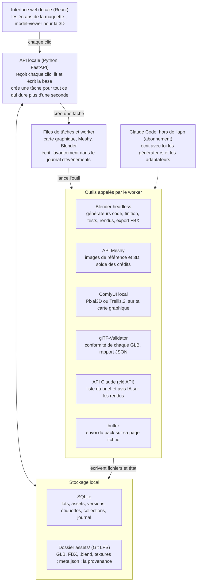

# Audit fonctionnel de la maquette

> Copie du document « Cahier des charges – Bibliothèque d'assets 3D », exportée le 17 oct. 2026. Ne la modifie pas ici : elle est régénérée depuis le document. Voir [README.md](README.md).

Aucun bouton n'est décoratif. Sur 76 éléments cliquables ou affichés, 70 reposent sur un outil réel dès la v1, 5 fonctionnent avec une réserve et 1 est reporté en v2. L'audit a trouvé 9 erreurs, toutes corrigées dans la maquette et dans le cahier des charges ; la plus coûteuse portait sur le prix de Meshy via l'API : 30 crédits par objet, pas 20. Une seconde vérification, faite sur le rendu de chaque écran, en a corrigé 13 autres et ajouté l'écran Réglages.

## Ce que j'avais faux ou survendu

Neuf points ne tenaient pas ; chacun est corrigé dans la maquette publiée et, quand il y figurait, dans le cahier des charges.

| Point | Ce que la maquette disait | La réalité | Correction |
| --- | --- | --- | --- |
| Coût Meshy | 20 crédits par objet, remesh gratuit, environ 50 objets par mois | Ce sont les tarifs de l'app web. Via l'API : 30 crédits par objet texturé, 3 crédits par image de référence | Estimations refaites partout : environ 23 objets IA par mois, références comprises |
| Coût Claude | L'abonnement Claude suffit | L'abonnement couvre Claude Code quand tu écris les générateurs. Les appels que l'app fait seule passent par une clé API : le mode `claude -p --bare`, recommandé pour les scripts, n'utilise pas la connexion de l'abonnement | Clé API avec plafond mensuel : ≈ 0,03 $ par brief, ≈ 0,02 $ par avis IA |
| Multi-vues | « Génération 3D depuis 3 vues » | Meshy accepte 1 à 4 images, mais trois images générées séparément ne montrent pas forcément le même objet | Une image par objet en v1 ; plusieurs vues seulement si tu les as |
| Matériaux partagés | Une modification se répercute sur tous les assets | Seuls les assets de la voie code réutilisent ces matériaux ; un asset IA a ses textures cuites | Libellé « voie code » ; un asset IA se régénère |
| Nouveau type d'objet | Chaque objet du brief a une voie | Un type sans générateur code, comme le râtelier, n'a rien d'automatique | Statut « À créer » dans le Brief : écrire le générateur avec Claude Code, ou passer en IA |
| Ajouter un générateur | « Brancher un générateur », sous-entendu sans code | Sans code seulement pour un workflow ComfyUI exporté en JSON ; tout autre service demande un adaptateur Python | Bouton renommé ; les deux cas sont décrits dans le tableau plus bas |
| Test « Moteur » | Import dans Godot ou Unity à chaque asset | Je n'ai pas pu vérifier l'import Godot en ligne de commande | v1 : glTF-Validator ; import moteur en v2 |
| Pixal3D par défaut | « Tourne en local sur ton GPU » | Comfy annonce du matériel grand public sans chiffrer la mémoire vidéo nécessaire | À tester sur ta carte avant de l'adopter ; sinon Meshy reste le défaut |
| Données entre écrans | Assets en revue affichés comme publiés, historique d'un asset pas encore gardé, pilum absent des références, compteurs différents | Erreurs de saisie de ma part | Un seul jeu de données, identique sur les 12 écrans |

## Seconde vérification, sur le rendu

Chaque écran a été rendu et relu, puis ses chiffres croisés avec les autres écrans. Treize points ne tenaient pas ; tous sont corrigés dans la maquette publiée.

| Écran | Problème | Correction |
| --- | --- | --- |
| Canvas | 5 écrans plus hauts que leur cadre ; les Références perdaient 800 px | Cadres ajustés à la hauteur réelle de chaque écran |
| Menu | Réglages ne menait nulle part | Écran Réglages dessiné : clés, outils locaux, plafonds, file de tâches |
| Accueil | La cloche ne s'ouvrait pas ; « Deux choses t'attendent » pour 4 actions | Panneau de notifications ; « Quatre actions t'attendent » |
| Menu, Accueil, Réglages | 240 crédits utilisés, incompatible avec ce que montrent les écrans | 570 : Vie du camp 240, Camp de légionnaires 192, Thermes 78, Forum romain 60 |
| Génération | 60 crédits pour le lot | 192 : les 162 prévus au brief plus la relance du brasero |
| Génération | Brasero relancé pour une erreur de dimensions, que la finition corrige seule | Relance pour des proportions fausses, qu'une mise à l'échelle ne corrige pas |
| Générateurs | Banc daté d'avant la génération qu'il compare ; objets dits « gardés » ou « rejetés » alors qu'ils attendent la revue | Banc daté d'après ; constats seulement ; il reprend les derniers essais Meshy, sans crédit |
| Générateurs, Brief, notes | « Claude choisit le générateur » | Claude classe, les règles choisissent ; règles complétées avec la voie mixte et « à créer » |
| Bibliothèque | Bandeau « passe Pixal3D au banc » alors que le banc est fini | Bandeau sur le résultat du banc |
| Fiche asset | Essai 1 relancé pour des défauts que la finition corrige ; pack publié avec la v1 sans le dire | Défaut non corrigible en finition ; avertissement « le pack contient encore la v1 » |
| Revue | « Import moteur » testé, alors qu'il est reporté en v2 | « Conformité du fichier » |
| Références | Le style s'applique « quelle que soit la voie » | Palette et budgets pour tout le lot, matériaux partagés pour la voie code |
| Styles | Style créé le 9 oct., après le lot Vie du camp qu'il a servi | Créé le 2 oct. |

Limite assumée de la maquette : la fiche asset est dessinée pour le casque, et chaque carte de la bibliothèque ouvre cette fiche.

## Ce qu'il y a derrière les boutons

Quatre couches suffisent. Un clic léger (filtrer, étiqueter, ranger) écrit directement en base ; un clic lourd (générer, tester, publier) crée une tâche que le worker confie à l'outil concerné.

Pile recommandée : l'API en Python, parce que Blender, trimesh et les clients Meshy et ComfyUI le sont déjà ; l'interface en React ; SQLite pour l'état. Le worker tient trois files en parallèle, carte graphique, Meshy et Blender ; la file carte graphique ne traite qu'une tâche à la fois (correction 12 de l'onglet Fonctionnalités). Claude Code et l'API Claude sont distincts : le premier sert quand tu construis, sur ton abonnement ; la seconde sert quand l'app tourne, sur une clé API.

## Écran par écran

Chaque ligne dit ce que l'élément déclenche vraiment et l'outil qui le fait. « Réel » : faisable en v1 avec des outils qui existent aujourd'hui. « Réel avec réserve » : marche, avec la limite écrite dans la ligne. La colonne Statut se change d'un clic si tu tranches autrement.

### Le parcours d'un lot

| Écran | Élément | Ce qu'il fait vraiment | Outil | Statut v1 |
| --- | --- | --- | --- | --- |
| Menu | Nouveau lot | Crée un lot vide (ligne en base, dossier `lots/<nom>/`) et ouvre le Brief | API locale, SQLite | Réel |
| Menu | Liens et badges | Les badges sont des comptages : lots en cours, assets gardés, résultat du banc non traité | SQLite | Réel |
| Menu | Collections épinglées | Ouvrent la Bibliothèque filtrée sur la collection | SQLite | Réel |
| Menu | Jauge Crédits Meshy | Solde lu par `GET /openapi/v1/balance` ; la date de renouvellement se saisit dans Réglages, l'API ne la donne pas | API Meshy | Réel avec réserve |
| Menu | Réglages | Clés API Meshy et Anthropic, chemin de Blender, adresse de ComfyUI, compte itch.io, plafonds, file de tâches | Fichier de config local | Réel |
| Accueil | Recherche globale | Cherche dans les noms, étiquettes, notes et lots | SQLite FTS5 | Réel |
| Accueil | Cloche | Ouvre le panneau des notifications : revue prête, test échoué après 3 relances, banc terminé, crédits à 80 % ; dans l'app seulement | Journal d'événements | Réel |
| Accueil | Chiffres clés | Comptages en base et solde Meshy | SQLite, API Meshy | Réel |
| Accueil | À faire | Calculé : revue prête, références à choisir, banc à trancher, asset à retravailler | SQLite | Réel |
| Accueil | Lots en cours, récents, activité | Requêtes et journal d'événements | SQLite | Réel |
| Lots | Onglets Tous, En cours, Terminés, Brouillons | Filtre sur l'état du lot | SQLite | Réel |
| Lots | Lien d'action de chaque lot | Rouvre le lot à son étape | Interface | Réel |
| En-tête de lot | Puce du style | Ouvre le style du lot | Interface | Réel |
| En-tête de lot | Dupliquer le lot | Copie le brief et les choix, sans les générations | SQLite, fichiers | Réel |
| En-tête de lot | Onglets d'étapes | Navigation ; une étape pas encore atteinte reste verrouillée | Interface | Réel |
| Brief | Thème, besoin, Stylisé ou Semi-réaliste | Paramètres envoyés à la proposition | Interface | Réel |
| Brief | Reproposer la liste | Claude propose objets, descriptions, dimensions et catégorie en JSON ; la voie vient ensuite des règles de routage, pas de Claude | API Claude (Sonnet 5.5), ≈ 0,03 $ | Réel |
| Brief | Case de chaque objet | Retire l'objet du lot | Interface | Réel |
| Brief | Voie « À créer » | Signale un type sans générateur code : tu l'écris avec Claude Code, ou tu passes l'objet en IA ; rien d'automatique | Claude Code (abonnement) | Réel avec réserve |
| Brief | Résumé et crédits | 30 crédits par objet IA ou mixte, plus 12 par objet pour ses 4 références | Calcul | Réel |
| Brief | Générer les références | Crée une tâche d'images par objet | File de tâches | Réel |
| Références | 4 propositions par objet | Images générées à partir de la planche du style et d'un prompt tiré de l'intention de l'objet | Meshy image-to-image, 3 crédits l'image | Réel |
| Références | 4 autres | Relance 4 images pour cet objet, soit 12 crédits | Meshy image-to-image | Réel |
| Références | Choisir une image | L'image devient l'entrée de la voie IA et la cible visuelle de la voie code | Fichiers | Réel |
| Références | Modifier le style | Ouvre Styles | Interface | Réel |
| Références | Lancer la génération 3D | Envoie chaque objet à son générateur | File de tâches | Réel |
| Génération | Progression par objet | État de chaque tâche : Meshy par sondage ou flux SSE, ComfyUI par websocket, Blender par la sortie du processus | API Meshy, API ComfyUI, Blender | Réel |
| Génération | Relance automatique, 3 au plus | Ce que la finition corrige seule ne relance rien (échelle, petits morceaux, triangles en trop) ; sinon nouvel essai avec la contrainte imposée | Blender headless | Réel |
| Génération | Objet mixte | Script d'assemblage : le chapiteau IA est mis à l'échelle du fût code ; raccord et écart de style restent à juger en revue | Blender headless | Réel avec réserve |
| Génération | Gérer les générateurs, Ouvrir la revue | Navigation | Interface | Réel |
| Revue | Tourner en 3D | Affiche le GLB, rotation libre, éclairage neutre | model-viewer | Réel |
| Revue | Tests 12/12 | Les 12 contrôles du cahier des charges, lancés après la finition | Blender (bpy), trimesh, glTF-Validator | Réel |
| Revue | Test « Moteur » | Import dans Godot ou Unity sans avertissement ; remplacé par glTF-Validator en v1 | Moteur en ligne de commande | Reporté en v2 |
| Revue | Avis IA, indicatif | Claude regarde les 5 rendus et écrit une remarque ; jamais bloquant | API Claude vision, ≈ 0,02 $ | Réel |
| Revue | Garder, Régénérer, Changer de voie, Jeter | Décision et motif en base ; Régénérer relance le même générateur, Changer de voie en prend un autre | SQLite, file de tâches | Réel |
| Revue | Valider la revue | Les assets gardés entrent en Bibliothèque, en privé | SQLite | Réel |

### Ranger, publier, régler

| Écran | Élément | Ce qu'il fait vraiment | Outil | Statut v1 |
| --- | --- | --- | --- | --- |
| Bibliothèque | Vues : Tout, En revue, Favoris, Publiés, Privés, Archivés | Filtres sur le statut | SQLite | Réel |
| Bibliothèque | Collections, Nouvelle collection | Groupes manuels ; un asset peut être dans plusieurs | SQLite | Réel |
| Bibliothèque | Filtres par étiquette | Combine les étiquettes ; Effacer le filtre remet tout | SQLite | Réel |
| Bibliothèque | Tri | Récents, nom, triangles, nombre de versions | SQLite | Réel |
| Bibliothèque | Étoile | Ajoute aux favoris | SQLite | Réel |
| Bibliothèque | Sélection multiple : Étiqueter, Ajouter à une collection, Archiver | Même action sur tous les assets cochés | SQLite | Réel |
| Bibliothèque | Exporter (.zip) | GLB, FBX, .blend, textures, meta.json et licence dans une archive | Python | Réel |
| Bibliothèque | Publier | Pousse la collection de publication sur itch.io ; la page itch.io et la déclaration IA se règlent à la main la première fois | butler | Réel avec réserve |
| Bibliothèque | Voir le banc d'essai | Navigation | Interface | Réel |
| Fiche asset | Tourner en 3D | Le GLB de la version active | model-viewer | Réel |
| Fiche asset | Les 5 vues | Rendus fixes : face, dos, profil, trois-quarts, dessus | Blender headless | Réel |
| Fiche asset | Comparer A et B | Deux versions côte à côte | model-viewer | Réel |
| Fiche asset | Rendre active | Change la version livrée ; si l'asset est publié, la prochaine publication pousse la nouvelle | SQLite, butler | Réel |
| Fiche asset | Privé, Public | Inclut ou non l'asset dans la prochaine publication | SQLite | Réel |
| Fiche asset | Favori, Archiver | Archiver retire l'asset des vues actives sans rien supprimer | SQLite | Réel |
| Fiche asset | Régénérer avec… | Nouvel essai avec le générateur choisi ; les versions précédentes restent | File de tâches | Réel |
| Fiche asset | Étiquettes automatiques | Tirées de l'intention et des mesures : type, matériau, taille, voie ; aucune IA | asset.yaml, meta.json | Réel |
| Fiche asset | Étiquettes manuelles et suggestions | Ajout libre ; les suggestions sont les étiquettes déjà utilisées | SQLite | Réel |
| Fiche asset | Collections | Coche les collections de l'asset | SQLite | Réel |
| Fiche asset | Provenance | Intention, image de référence, générateur, date et coût de chaque version | meta.json | Réel |
| Fiche asset | Fichiers, Tout télécharger | GLB natif, FBX exporté par Blender, .blend de travail, textures | Blender headless | Réel |
| Générateurs | Banc d'essai | Les mêmes 5 objets passent dans 2 générateurs ; tests automatiques et ta note. Côté Meshy, il reprend le dernier essai de chaque objet, donc sans crédit ; un objet jamais généré coûte 30 crédits | File de tâches | Réel |
| Générateurs | Adopter Pixal3D, Revenir à Meshy 6 | Change la règle de routage de la voie IA | Config | Réel |
| Générateurs | Reprendre les versions Pixal3D (3 assets) | Ajoute la version Pixal3D du banc à l'amphore, au brasero et à la lampe ; les anciennes versions restent | File de tâches | Réel |
| Générateurs | Paramètres, Désactiver | Réglages par générateur : triangles visés, taille des textures, adresse ComfyUI | Config | Réel |
| Générateurs | Ajouter un générateur | Workflow ComfyUI exporté au format API : formulaire, sans code. Tout autre service : un adaptateur Python à écrire avec Claude Code | API ComfyUI, Claude Code | Réel avec réserve |
| Générateurs | Modifier les règles | Associe une catégorie d'objet à un générateur | Config | Réel |
| Styles | Nouveau style, Dupliquer en v1, Modifier | style.yaml versionné | Fichiers, Git | Réel |
| Styles | Planche et palette | Images et couleurs données au générateur d'images | Meshy image-to-image | Réel |
| Styles | Matériaux partagés · voie code | Bibliothèque de matériaux Blender ; une modification relance les générateurs code, sans crédit | Blender headless | Réel |
| Styles | Budgets | Triangles et densité de texels par catégorie : ce sont les seuils des tests | Config | Réel |

### Réglages

| Écran | Élément | Ce qu'il fait vraiment | Outil | Statut v1 |
| --- | --- | --- | --- | --- |
| Réglages | Tester la connexion · Meshy | Lit le solde ; une clé refusée se voit tout de suite | `GET /openapi/v1/balance` | Réel |
| Réglages | Renouvellement et alerte des crédits | Date saisie à la main, l'API ne la donne pas ; alerte dans l'app à 80 % | Config, journal d'événements | Réel |
| Réglages | Tester la connexion · API Claude | Liste les modèles accessibles avec la clé | `GET /v1/models` de l'API Claude | Réel |
| Réglages | Plafond mensuel et dépense du mois | L'app cesse d'appeler l'API une fois le plafond atteint ; la dépense vient des tokens comptés à chaque appel. Le plafond de la Console sert de filet | Config, réponses de l'API | Réel |
| Réglages | Tester butler | Vérifie que butler est installé et connecté à ton compte | butler | Réel |
| Réglages | Chemins de Blender et de glTF-Validator | Vérifie que chaque exécutable répond | Config | Réel |
| Réglages | Adresse de ComfyUI | Vérifie que le serveur répond et lit la carte graphique et sa mémoire | `GET /system_stats` de ComfyUI | Réel |
| Réglages | File de tâches : tâches en même temps, relances | Limites lues par le worker à chaque tâche | Config | Réel |
| Réglages | Enregistrer, Annuler | Écrit ou abandonne le fichier de configuration local | Fichier de config | Réel |

## Avant d'écrire du code

Cinq vérifications sur ta machine lèvent les réserves restantes ; aucune ne prend plus d'une soirée.

- [ ] Lancer Pixal3D dans ComfyUI sur ta carte graphique avec une image de test. S'il termine sans manquer de mémoire, il peut devenir le défaut de la voie IA ; sinon Meshy le reste.
- [ ] Créer la clé API Meshy et appeler `GET /openapi/v1/balance` pour confirmer que les 1 000 crédits de Meshy Pro sont utilisables par l'API.
- [ ] Créer une clé API Claude dans la Console, avec un plafond de dépenses de 5 $ par mois.
- [ ] Passer un GLB sorti de Meshy dans glTF-Validator, puis le réimporter dans Blender en ligne de commande : c'est la base des 12 tests.
- [ ] Créer la page itch.io à la main et y faire la déclaration IA, avant la première publication par butler.

## Sources

- [Meshy : tarifs de l'API](https://docs.meshy.ai/en/api/pricing)
- [Meshy : Image to 3D, paramètres et suivi des tâches](https://docs.meshy.ai/en/api/image-to-3d)
- [Claude Code : exécution en script et mode --bare](https://code.claude.com/docs/en/headless)
- [Claude : tarifs de l'API](https://platform.claude.com/docs/en/about-claude/pricing)
- [Comfy : Trellis.2 et Pixal3D natifs](https://blog.comfy.org/p/trellis2-and-pixal3d-are-now-native)
- [ComfyUI : routes HTTP et WebSocket du serveur](https://docs.comfy.org/development/comfyui-server/comms_routes)
- [Khronos : glTF-Validator](https://github.com/KhronosGroup/glTF-Validator)
- [itch.io : publier avec butler](https://itch.io/docs/butler/pushing.html)
- [model-viewer](https://modelviewer.dev/)
